# NERV OS for Nothing Phone (3)

An Evangelion-styled custom launcher and system theme for the **Nothing Phone (3)** running **Nothing OS 5 (Android 17)**.
No root, no bootloader unlock, and everything can be undone.

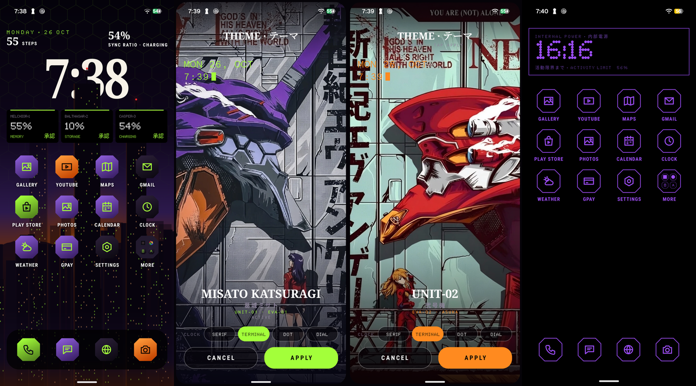

Four "units" restyle the whole phone in one tap: wallpaper, icons, widgets, lock screen, panel colours, sounds, notifications,
Glyph Matrix and battery saver.

| Unit | Colours |
|---|---|
| Misato Katsuragi (Unit-01) | purple + neon green |
| Unit-00 (Rei) | light blue + white |
| Unit-02 (Asuka) | red + orange |
| Mari | pink + peach |

## What's in the box

| App | Package | What it does |
|---|---|---|
| **NERV Home** | `dev.nervos.home` | The launcher: Tokyo-3 skyline, MAGI widgets, octagon icons, app drawer, theme picker, and all the animations below |
| **NERV Icons** | `dev.nervos.icons` | Octagon icon pack used by NERV Home |
| **NERV Glyph** | `dev.nervos.glyph` | Glyph Matrix toys for the back panel, plus the charging animation |
| **Quickstar** | `dev.rishi.quickstar` | Settings companion: system palette tint, NERV sounds, NERV notification banners, lock-screen hold, quick-settings tile layout |

## Animations

**Fingerprint unlock:** a wave of hexagons unfolds from the sensor.

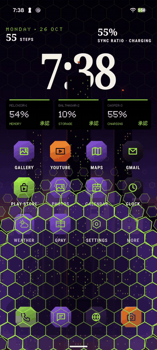

**First unlock of the day:** an episode title card, then the hex wave.

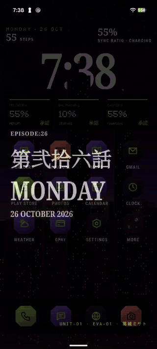

**Unplug:** "UMBILICAL CABLE DISCONNECTED". **Plug in:** "EXTERNAL POWER CONNECTED".

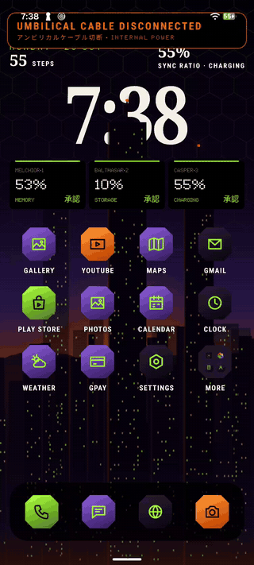 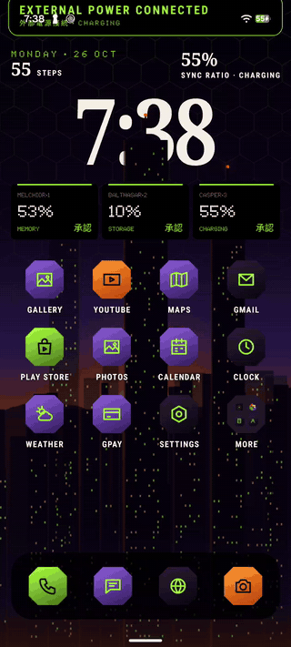

**Battery saver on:** Tokyo-3's towers sink into the Geofront, then the saver look takes over (pure black, thin outlines, an
"activity limit" countdown). **Off:** the city comes back.

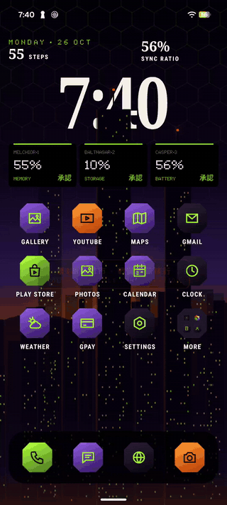 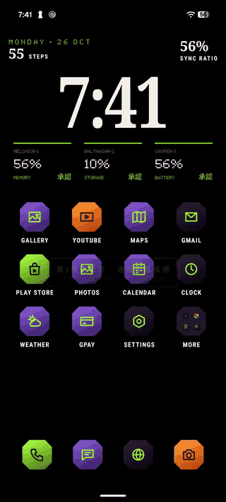

**City defence banner** on its own:

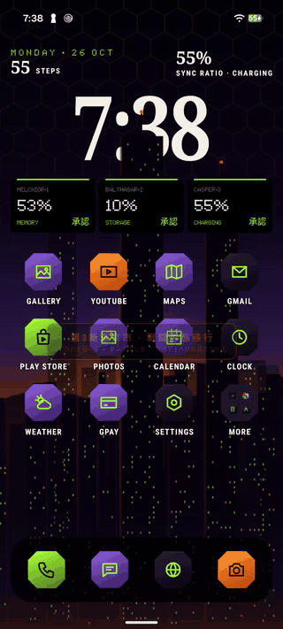

Also: NERV banners for pop-up notifications (calls show "PATTERN BLUE · INCOMING CALL"), a charging screen with the A.T. Field on
the display and the Glyph Matrix with a per-unit power-up sound and haptic, and a MAGI console for app search.

## Screenshots

| Home | App drawer (MAGI search) | Battery saver |
|:-:|:-:|:-:|
| 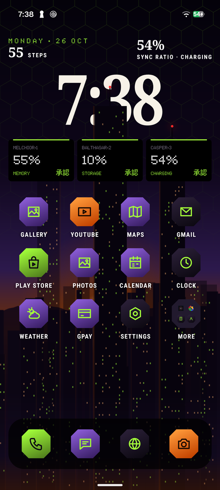 | 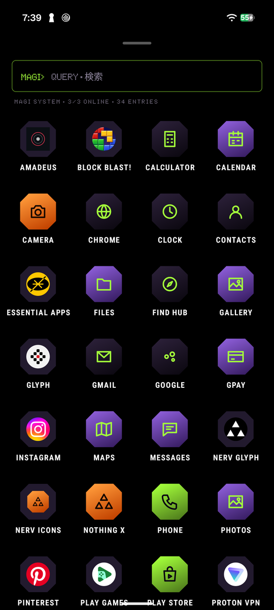 | 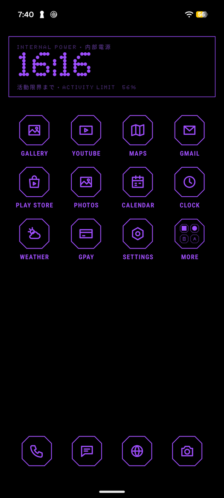 |

**Theme picker.** Hold the home screen (or the lock screen) and swipe through the units, each previewed as its lock screen.
The CLOCK row picks the lock-screen clock face.

| Misato | Unit-00 | Unit-02 | Mari |
|:-:|:-:|:-:|:-:|
| 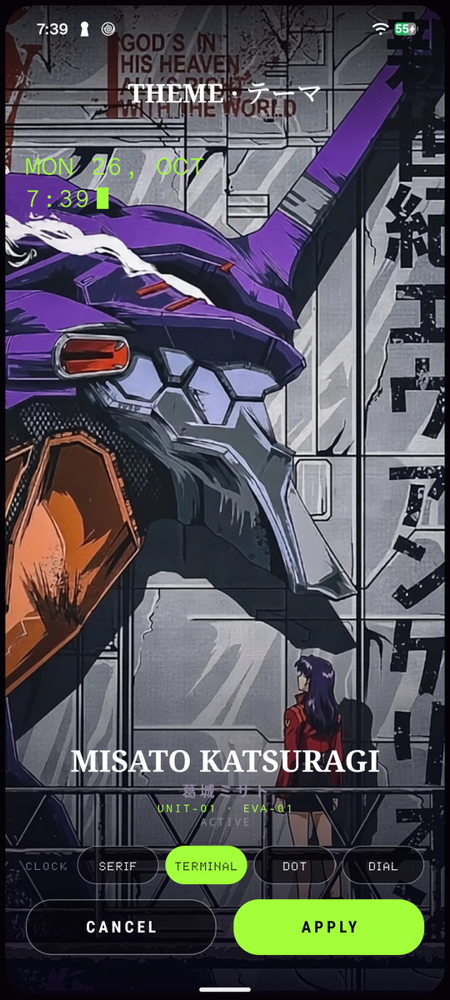 | 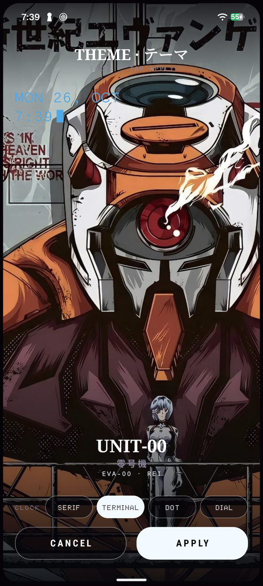 | 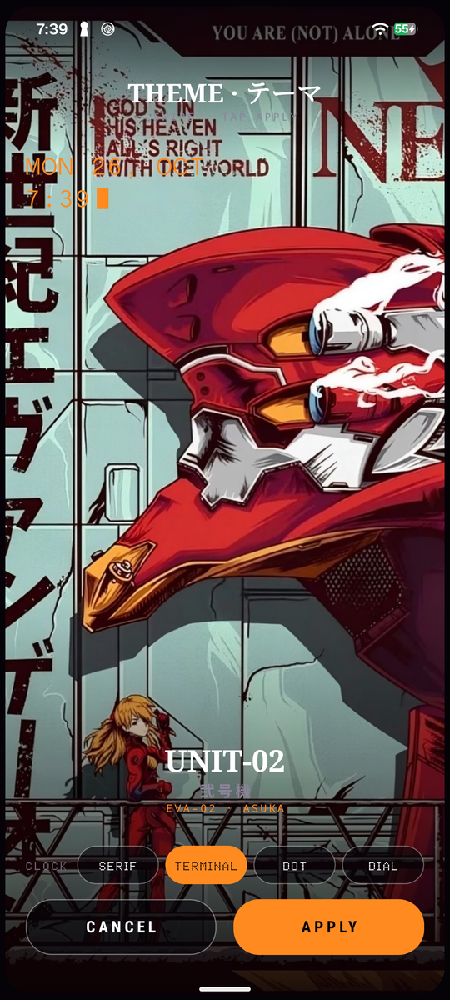 | 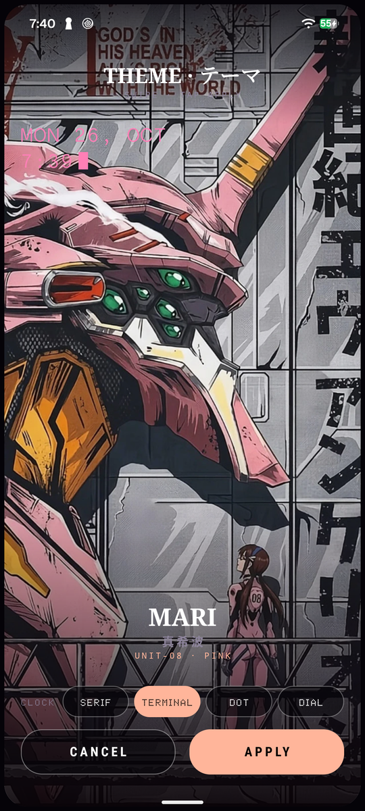 |

| Glyph toys | Quickstar: Panel | Quickstar: Control |
|:-:|:-:|:-:|
| 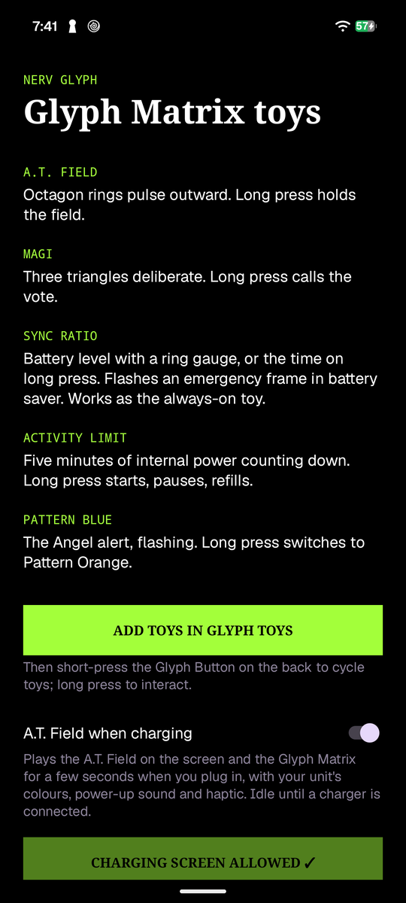 | 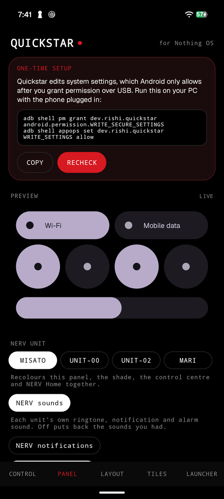 | 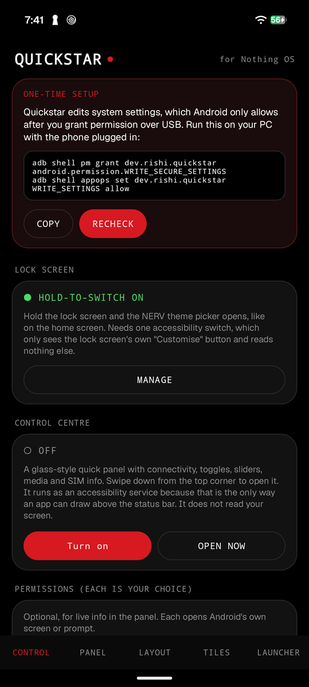 |

Everything is described in more detail in [docs/PHONE_CUSTOMIZATIONS.md](docs/PHONE_CUSTOMIZATIONS.md).

---

## Install it on your own phone (step by step)

**You need:** a Nothing Phone (3) on Nothing OS 5 (the launcher, icons and Quickstar may work on other Android 13+ phones, but the
Glyph Matrix toys are Phone (3) only and the system tweaks are tuned for Nothing OS), a USB cable, and a Windows, macOS or Linux PC.

### 1. Get the files

```bash
git clone https://github.com/Rishi-Koushik/Custom-Evangelion-Based-Launcher-For-Evangelion.git
cd Custom-Evangelion-Based-Launcher-For-Evangelion
```

Or press **Code → Download ZIP** on GitHub and unzip it.

### 2. Install ADB on the PC

Download [Android SDK Platform-Tools](https://developer.android.com/tools/releases/platform-tools), unzip it, and make sure `adb`
runs from a terminal (add the folder to your PATH, or run it from inside that folder).

### 3. Turn on USB debugging on the phone

1. **Settings → About phone → Nothing OS** and tap **Build number** 7 times to unlock Developer options.
2. **Settings → System → Developer options → USB debugging: on.**
3. Plug the phone in, accept **Allow USB debugging** on the phone, then check the PC sees it:

```bash
adb devices
```

Your device should be listed as `device` (not `unauthorized`).

### 4. Install the four apps

Run these from the folder you cloned:

```bash
adb install -r apk/NERV-Icons-0.2.apk
adb install -r apk/NERV-Home-1.6.apk
adb install -r apk/NERV-Glyph-0.7.apk
adb install -r apk/Quickstar-0.1.apk
```

### 5. Give the apps the permissions they need

```bash
# Quickstar edits system settings; Android only allows this after an ADB grant
adb shell pm grant dev.rishi.quickstar android.permission.WRITE_SECURE_SETTINGS
adb shell appops set dev.rishi.quickstar WRITE_SETTINGS allow

# step counter on the home screen
adb shell pm grant dev.nervos.home android.permission.ACTIVITY_RECOGNITION
```

> The Quickstar grants are lost if you uninstall it. The app shows a setup card until they are done.

### 6. Make NERV Home your launcher

Press the Home button and choose **NERV Home → Always**, or go to **Settings → Apps → Default apps → Home app → NERV Home**.

### 7. Pick your unit

Hold an empty spot on the home screen, swipe between the four units, choose a clock face, and tap **Apply**.
That sets the wallpapers (home and lock), icons, widgets, panel colours and battery-saver look.

### 8. Turn on the system integrations (optional but recommended)

Open **Quickstar** and go through its tabs:

| Want | Do this |
|---|---|
| Hold the lock screen to open the theme picker | **Settings → Accessibility → NERV lock-screen hold → on** (it only watches for Nothing's "Customise" button) |
| NERV banners for notifications | Quickstar → **Panel** → **NERV notifications** chip, then allow **notification access** for "NERV notifications" (and keep the lock-screen hold service on, which draws the banners) |
| NERV ringtone / notification / alarm sounds | Quickstar → **Panel** → **NERV sounds** chip |
| Theme picker tile in quick settings | Pull down the panel → pencil → add the **NERV theme** tile |
| Panel colours / serif system font | Quickstar → **Panel** (follows the unit; **Restore original** undoes it) |

### 9. Glyph Matrix toys and the charging animation

1. **Settings → Glyph Interface → Glyph Toys** and add **A.T. Field, MAGI, Sync Ratio, Activity Limit, Pattern Blue**.
2. Short-press the Glyph button on the back to cycle toys; long-press to interact.
3. Open **NERV Glyph**, keep **A.T. Field when charging** on, and allow **Display over other apps** when asked.

### 10. Try the animations without waiting for them

```bash
adb shell am start -n dev.nervos.home/.HomeActivity --ez hexwave true      # unlock hex wave
adb shell am start -n dev.nervos.home/.HomeActivity --ez titlecard true    # episode title card
adb shell am start -n dev.nervos.home/.HomeActivity --ez umbilical false   # unplug banner
adb shell am start -n dev.nervos.home/.HomeActivity --ez umbilical true    # plug-in banner
adb shell am start -n dev.nervos.home/.HomeActivity --ez cityshift true    # city defence
```

Battery saver and charging need no preview: turn on battery saver, or plug in the charger.

### 11. (Optional) Debloat

`src/debloat/nothing-phone-3.txt` lists optional Google and Nothing apps removed for the main user only (system copies stay, so
they are restorable). Read the list first and delete any line you want to keep, then:

```bash
bash src/debloat/debloat.sh src/debloat/nothing-phone-3.txt     # remove
bash src/debloat/restore.sh src/debloat/nothing-phone-3.txt     # put them back
```

Set `ADB=adb` in your environment if the script cannot find it.

---

## Undo everything

- **Launcher:** Settings → Apps → Default apps → Home app → Nothing Launcher.
- **Panel, tiles, clock, sounds:** Quickstar → Panel → **Restore original**.
- **Services:** Settings → Accessibility (and Notification access) → switch them off.
- **Apps:** uninstall them normally.
- **Debloated apps:** `bash src/debloat/restore.sh src/debloat/nothing-phone-3.txt`.

## Troubleshooting

- **`adb devices` shows nothing or `unauthorized`:** unplug, replug, accept the prompt on the phone; try another cable or port.
- **`INSTALL_FAILED_UPDATE_INCOMPATIBLE`:** an app with the same name signed by a different key is installed. Uninstall it first.
- **Quickstar says setup is needed:** re-run the two grant commands in step 5 and tap **Recheck**.
- **Lock-screen hold or banners do nothing:** make sure the accessibility service / notification access is actually switched on.
- **Wallpaper looks zoomed:** run **Apply** again from the picker; Nothing OS zooms lock wallpapers unless a crop hint is set.
- **Battery saver look does not appear while charging:** Android turns battery saver off while plugged in. Unplug first.

## Build from source

Source is in [`src/`](src):

| Folder | App | Build |
|---|---|---|
| `src/nerv-home` | NERV Home | Android Studio, or `./gradlew assembleRelease` (JDK 17+, Android SDK 35) |
| `src/nerv-icons` | NERV Icons | same |
| `src/nerv-glyph` | NERV Glyph | same, **after** adding Nothing's Glyph Matrix SDK (below) |
| `src/quickstar` | Quickstar | Windows: `.\build.ps1 -Install` (no Gradle; needs Android SDK build-tools 35 and `adb` on PATH) |
| `src/tools` | generators | `gen_units.py` (palettes), `gen_lockscreens.py`, `gen_sounds.py`, `gen_fonts.py` |

**Glyph SDK:** Nothing's licence does not allow redistributing the SDK, so it is not in this repo. Download the
[Glyph Matrix Developer Kit](https://github.com/Nothing-Developer-Programme/GlyphMatrix-Developer-Kit) and copy
`glyph-matrix-sdk-2.0.aar` to `src/nerv-glyph/app/libs/`.

The release builds are signed with the Android **debug** key so they install over ADB. If you build your own they will be signed
with a different key, so uninstall the prebuilt ones first.

## Notes

- Built for and tested on a Nothing Phone (3) (A024), Nothing OS 5.0 (Android 17). Other devices are untested.
- Nothing's pull-down can only be tinted, not reshaped, without root. Boot animation, system font and call screen cannot be replaced without root.
- This is a **fan project**. Evangelion and its characters and artwork belong to their respective owners (Khara / Gainax). Not
  affiliated with or endorsed by Nothing Technology Limited. You are changing system settings on your own phone, so use it at your own risk.
- No licence has been chosen yet for the code in this repo; until one is added, all rights are reserved by the author.
